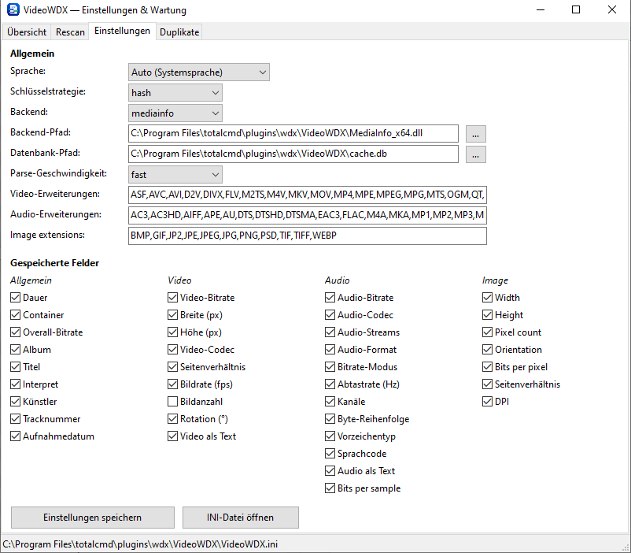
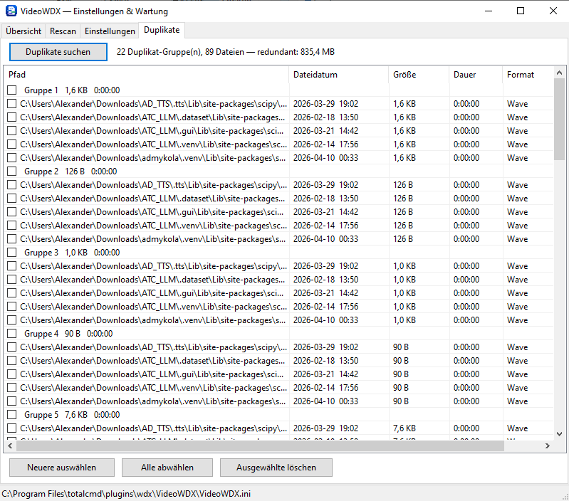

# VideoWDX

A [Total Commander](https://www.ghisler.com/) content plugin (`.wdx`) that exposes video, audio, image, and photo/EXIF metadata as sortable, searchable columns — duration, resolution, codec, bitrate, aspect ratio, GPS location, camera settings, and more.




---

## Features

- **48 metadata fields** across five groups: General, Video, Audio, Image, Photo/EXIF
- **Multiple display units per field** where it makes sense — e.g. aspect ratio as `4:3` or `1.333`, GPS as decimal/DMM/DMS/Maidenhead locator, image/video orientation as `Landscape`/`H`/a rotation angle
- **SQLite cache** — each file is read once; TC columns repaint instantly from cache
- **Two extraction backends**: MediaInfo (recommended) or ffprobe, plus a built-in EXIF reader for images (no external DLL needed for Photo fields)
- **Two cache key strategies**: by file path or by partial hash (detects renames/moves, enables duplicate detection)
- **Duplicate finder** — finds files with an identical content hash (requires hash strategy)
- **Similarity search** — perceptual-hash/SSIM based visual similarity for videos and images
- **Parallel indexing** — configurable worker-thread pool for bulk scans and background read-ahead
- **Background read-ahead** — while browsing, the plugin lazily pre-extracts metadata for a folder after a few cache misses, using a pool of worker threads
- **Delete/move detection** — when you navigate away from a folder, the plugin checks in the background whether its cached files still exist and drops orphaned DB rows automatically (off by default, opt-in)
- **One-time backend warning** — if the configured MediaInfo/ffprobe backend can't be found, both the plugin and the GUI tool show a single warning on load instead of failing silently
- **GUI maintenance tool** (`VideoWdxTool64.exe`) for scanning, statistics, duplicates, similarity search, and settings — including a per-folder "rescan only this folder" context menu
- **Localized UI**: English, German, French, Russian, Ukrainian; auto-detects OS language
- Ships as both 32-bit (`.wdx`) and 64-bit (`.wdx64`) — TC loads the matching bitness

---

## Installation

1. In Total Commander, open **Configuration → Plugins → Content plugins (.wdx)**.
2. Click **Add** and select `VideoWDX.wdx` (or `.wdx64`) from the plugin folder — or drag the `pluginst.inf` file onto the TC window for automatic installation.
3. Restart Total Commander.
4. Add columns via **Show → Define column sets** or the custom column dialog.

Place `VideoWDX.ini` next to the plugin DLL. If it is absent, the plugin writes a default one on first load. If the configured backend DLL/EXE (`BackendPath`) cannot be found, both the plugin and the GUI tool show a one-time warning dialog instead of failing silently — check `BackendPath` in `VideoWDX.ini` if you see it.

---

## Fields

Fields are organized into five groups. Enable or disable each one in the Settings tab of the GUI tool or directly in `VideoWDX.ini`. Where a field supports more than one **unit**, the unit is selectable per column via TC's column configuration dialog (first unit listed is the default).

### General

| Field | Default | Description | Units |
|-------|:-:|-------------|-------|
| Duration | on | Playback length | hh:mm:ss.fff · hh:mm:ss · s · ms |
| Container | on | Container format (e.g. Matroska, MPEG-4, AVI) | — |
| DisplayAspectRatio | on | Video display aspect ratio | Ratio (`4:3`) · Decimal (`1.333`) |
| OverallBitrate | on | Combined stream bitrate | Bps · KBps · MBps |
| Album | off | Tag: album name | — |
| Title | off | Tag: title | — |
| Performer | off | Tag: performer | — |
| Artist | off | Tag: artist | — |
| TrackNumber | off | Tag: track number | — |
| RecordedDate | off | Tag: recording date | — |

### Video

| Field | Default | Description | Units |
|-------|:-:|-------------|-------|
| VideoCodec | on | Codec name (e.g. AVC, HEVC, AV1) | — |
| VideoBitrate | on | Video stream bitrate | Bps · KBps · MBps |
| Width | on | Frame width | px |
| Height | on | Frame height | px |
| VideoFPS | on | Frame rate | fps |
| VideoRotation | off | Rotation metadata | deg (raw value, text) · H/V (Landscape/Portrait/Square) · Angle (signed, e.g. `+90`, `-90`) |
| VideoFrameCount | off | Total number of frames | — |
| AllVideoAsString | off | Human-readable summary: codec, bitrate, resolution, fps | — |

### Audio

| Field | Default | Description | Units |
|-------|:-:|-------------|-------|
| AudioCodec | on | Codec name (e.g. AAC, AC-3, FLAC, Opus) | — |
| AudioBitrate | on | Audio stream bitrate | Bps · KBps · MBps |
| AudioFormat | on | Low-level audio format | — |
| AudioBrMode | on | Bitrate mode (CBR / VBR) | — |
| AudioStreamCount | off | Number of audio tracks | — |
| AudioSamplingRate | off | Sampling frequency | Hz |
| AudioChannels | off | Number of channels | — |
| AudioFmtEndianness | off | Byte order (Little / Big) | — |
| AudioFmtSign | off | Sample sign (Signed / Unsigned) | — |
| AudioResolution | off | Bits per sample | bit |
| AudioLangCode | off | ISO 639 language code of the first audio track | — |
| AllAudioAsString | off | Human-readable summary: bitrate, sample rate, channels | — |

### Image

| Field | Default | Description | Units |
|-------|:-:|-------------|-------|
| ImgWidth | on | Image width | px |
| ImgHeight | on | Image height | px |
| ImgPixels | on | Total pixel count | px · kpx · Mpx · Gpx |
| ImgOrientation | on | Orientation, accounting for EXIF rotation | Portrait/Landscape/Square · H/V (short form) · Angle (signed rotation, from EXIF) · EXIF (raw tag text) |
| ImgBitsPerPixel | off | Total bit depth (e.g. 24 for 8-bit RGB) — always computed from the actual pixel format, not the possibly per-channel EXIF tag | bpp |
| ImgRatio | off | Image aspect ratio | Ratio (`3:2`) · Decimal (`1.5`) |
| ImgDPI | off | Resolution | dpi |
| ImgParameters | off | Free-text metadata (e.g. AI generation parameters embedded in PNG/JPEG) | — |

### Photo / EXIF

| Field | Default | Description | Units |
|-------|:-:|-------------|-------|
| PhotoShutterSpeed | off | Exposure time (e.g. `1/250 s`) | — |
| PhotoFNumber | off | Aperture (e.g. `f/2.8`) | — |
| PhotoFocalLength35mm | off | Focal length, 35 mm equivalent | mm |
| PhotoISO | off | ISO sensitivity | — |
| PhotoFlash | off | Flash status, decoded | — |
| PhotoDateTimeOriginal | off | Date/time the photo was taken | — |
| PhotoCamera | off | Camera make + model | — |
| PhotoGPS | off | GPS location (empty if lat/lon is exactly 0,0 — treated as "no coordinate") | decimal · DMM · DMS · Maidenhead6 (6-digit locator) · Maidenhead8 (8-digit locator) |
| PhotoHasThumbnail | off | Whether an embedded EXIF thumbnail is present | — |
| PhotoManufacturer | off | Recording/writing software or hardware | — |

Image and Photo/EXIF fields are extracted with a built-in EXIF reader (no external DLL required) for JPEG/TIFF; other formats (PNG, BMP, GIF, WEBP, PSD) use format-specific header parsing for dimensions/bit depth.

---

## GUI Tool — VideoWdxTool64.exe

Open `VideoWdxTool64.exe` (in the plugin folder) to manage the cache and adjust settings. The tool connects to the same SQLite database as the plugin. If the configured backend can't be found, a one-time warning is shown on startup.

### Overview tab

Displays cache statistics:

- Total entries, database size, oldest and newest scan timestamp
- Hash duplicate count (only meaningful with hash key strategy)
- Top containers, video/audio codecs, audio languages
- Top longest, shortest, and largest files
- Image orientation/bit-depth/format breakdowns and largest images

Buttons:

| Button | Action |
|--------|--------|
| Refresh | Re-read statistics from the database |
| Cleanup | Delete cache entries whose file no longer exists on disk |
| Compact | Run `VACUUM` to shrink the database file |
| Clear database… | Delete **all** cache entries (prompts for confirmation) |

### Rescan tab

Maintains a list of folders to be scanned in bulk (e.g. a media library). Scanning uses a pool of worker threads (see `ScanThreads` below) on local fixed drives; network and removable drives always scan with a single thread.

| Button / action | Effect |
|--------|--------|
| Add folder… | Add a directory to the scan list |
| Remove folder | Remove the selected directory |
| Re-scan existing | Re-extract metadata for every file already in the database |
| Scan directories | Scan all listed folders — add new files, update changed ones |
| Add new from directories | Scan listed folders but skip paths already present in the database |
| Right-click a folder → **Rescan this folder only** | Run a full scan (equivalent to "Scan directories") restricted to just the selected folder, leaving the other configured folders untouched |
| Cancel | Abort the running scan |

Progress is shown at the bottom with a file counter.

### Settings tab

All changes are saved to `VideoWDX.ini`. Plugin-affecting settings (fields, backend, strategy) take effect after restarting Total Commander. The language selection takes effect after restarting the tool.

| Setting | Description |
|---------|-------------|
| **Language** | UI language: Auto (OS), English, German. (French, Russian, and Ukrainian translations also exist and are used automatically if the OS language matches, or can be forced via `Language=fr`/`ru`/`uk` in the INI — not yet listed in this dropdown.) |
| **Key strategy** | `path` — cache key is the full file path (fast, no file reading on cache hit). `hash` — cache key is a partial content hash (survives rename/move; required for duplicate detection). |
| **Enable similarity search** | Shows the Similars tab. Enable to activate fingerprint building and visual search. |
| **Media** | Which file types are processed when building fingerprints: `video only`, `image only`, or `video + image`. Enabled only when similarity search is active. |
| **Backend** | `mediainfo` (recommended) or `ffprobe` |
| **Backend path** | Path to `MediaInfo.dll` or `ffprobe.exe`. A bare filename is resolved relative to the plugin folder. |
| **Database path** | Path to `cache.db`. Leave empty to use the default location (`%APPDATA%\TC_VideoWDX\cache.db`). |
| **Parse speed** | `fast` — read container header only (sufficient for all fields, very quick). `accurate` — scan the whole file (more precise bitrates, significantly slower). `smart` — read the header first; only rescan a file with a full scan if `VideoBitrate`/`AudioBitrate` came back empty (common for MKV, or MP4 files whose muxer omitted the optional bitrate atom). Slower than `fast` only for the files that actually need it. |
| **Video / Audio / Image extensions** | Comma-separated list of uppercase extensions the plugin should process. Files with other extensions are ignored without opening. |
| **Read-ahead laziness (0=off)** | Number of consecutive cache misses in a folder before background read-ahead kicks in for the rest of that folder. `0` disables read-ahead. See below for the full read-ahead behavior. |
| **Detect delete/move** | When you navigate away from a folder, check in the background whether every file that was cached for it still exists, and drop the DB row for any that don't. Default: off. See below for details. |
| **Saved fields** | Per-field enable/disable switches, grouped by General/Video/Audio/Image/Photo. Disabled fields do not appear in TC's column list. |

**INI-only settings** (no GUI control; edit `VideoWDX.ini` directly):

| Key | Section | Default | Description |
|-----|---------|---------|-------------|
| `ScanThreads` | `[General]` | 8 | Maximum worker threads for indexing (Rescan tab and background read-ahead). Effective count: `Min(CPU cores, ScanThreads)` on local fixed drives; always 1 on network/removable drives. Read-ahead uses half of this value (minimum 1). |
| `DetectDeletedMoved` | `[General]` | 0 | Same as the "Detect delete/move" GUI setting. |
| `MaxSeconds` | `[ReadAhead]` | 90 | Maximum duration a single read-ahead run is allowed to keep working in a folder. |
| `Misses` | `[ReadAhead]` | 60 | Same value as the "Read-ahead laziness" GUI setting. |
| `Removable` | `[ReadAhead]` | 1 | Whether read-ahead is also allowed on removable drives (`DRIVE_REMOVABLE`). Network drives are never read ahead. |

**Read-ahead behavior:** while browsing in TC, the plugin tracks consecutive cache misses per folder. Once the threshold (`Misses`) is reached, it launches background worker threads (up to half of `ScanThreads`) to pre-extract metadata for the rest of that folder, so subsequent column repaints are served from cache instead of triggering per-file extraction. It only runs on local fixed drives (and optionally removable drives), never on network shares, and stops automatically after `MaxSeconds` or when you navigate to a different folder.

**Delete/move detection:** whenever TC reports that you've navigated to a new folder, the plugin checks — in the background — whether every file cached for the folder you just *left* still exists on disk (non-recursive, that folder only), and deletes the DB row for any that are gone. This is separate from and complementary to the Duplicates tab's rename/move recognition under the hash key strategy: a genuine rename/move is still picked up from cache via its content hash, while a real deletion (or a move somewhere the hash strategy won't reconnect, e.g. under the path strategy) is what gets cleaned up here. It uses the same drive-type policy as read-ahead (local fixed drives, optionally removable) and never touches network shares. **Side effect to be aware of:** merely browsing away from a folder can trigger DB writes for it — disable `DetectDeletedMoved` if you'd rather rely on the manual "Cleanup" button in the Overview tab.

### Duplicates tab

> **Only available when the key strategy is set to `hash`.**

Finds files in the database whose partial content hash is identical.

| Button | Action |
|--------|--------|
| Find duplicates | Query the database for hash-matched groups |
| Select newer | In each group, select the file with the more recent modification date |
| Unselect all | Clear all checkboxes |
| Delete selected | Permanently delete the checked files (prompts for confirmation) |

Files are shown grouped; the group header displays the shared file size and duration as additional context. Right-click a file to open its containing folder or delete it.

### Similars tab

> **Only available when "Enable similarity search" is checked in the Settings tab.**  
> Requires `ffmpeg.exe` to be available (placed next to the backend or on `PATH`).

Finds visually similar video and image files using a perceptual hash (pHash) and optionally SSIM.

| Button | Action |
|--------|--------|
| Build fingerprints | Extract pHash and gray-image data for all files in the cache. Click again while running to cancel. |
| Find similars | Compare fingerprints in memory and list similar pairs |
| Compact sim.db | Run `VACUUM` on the fingerprint database |

**Controls:**

| Control | Description |
|---------|-------------|
| Thumb mode | Frame layout used for fingerprinting (e.g. `2x2` = 4 frames at 16/40/56/80 %) |
| Gray size | Downscale resolution for pHash/SSIM (px, square). Smaller = faster, larger = more precise. Default: 24 |
| Mode | Comparison mode: `pHash only`, `SSIM only`, or `both` |
| Threshold (bits) | Minimum matching bits out of 64 for pHash (higher = stricter). Default: 57 |
| SSIM threshold | Minimum SSIM score 0–1 for SSIM match. Default: 0.89 |
| Force rebuild | Re-compute fingerprints even for files already stored in `similar.db` |

Similar pairs are shown with a score (higher = more similar). Hovering over a thumbnail shows a larger preview. Right-click opens the containing folder or deletes the file.

**INI keys (`[Similar]` section):**

| Key | Default | Description |
|-----|---------|-------------|
| `Enabled` | 0 | Show the Similars tab |
| `SimilarDbPath` | *(empty)* | Path to `similar.db`; empty = auto-derive next to `cache.db` |
| `ThumbMode` | `2x2` | Frame layout for fingerprinting |
| `GraySize` | 24 | Gray-image downscale size |
| `CellSize` | 160 | Pixel size of each frame cell during extraction |
| `ThresholdBits` | 57 | pHash match threshold |
| `ThresholdSSIM` | 0.89 | SSIM match threshold |
| `SSIMMode` | 0 | 0 = pHash only, 1 = SSIM only, 2 = both |
| `SSIMBlockSize` | 8 | Block size for SSIM computation |
| `SSIMPrefilterBits` | 44 | Minimum pHash bits required before SSIM is computed |
| `SameDurationMod` | 1 | Bonus bits when files have similar duration (±1 s) |
| `DifferentDurationMod` | 4 | Penalty bits when files have very different duration |
| `MediaFilter` | 2 | 0 = video only, 1 = images only, 2 = video + images |
| `ForceRebuild` | 0 | 1 = always recompute, even if fingerprint exists |

---

## Command-line usage — VideoWdxTool64.exe

The tool can be driven from the command line for use in scheduled tasks or scripts. When any argument is recognized, the tool runs silently (Rescan tab is shown), performs the requested action, and exits automatically when finished.

```
VideoWdxTool64.exe [/add <folder>] [/rescan | /fastscan]
```

Both `/` and `--` prefixes are accepted (e.g. `--rescan` is equivalent to `/rescan`).

### Parameters

| Parameter | Description |
|-----------|-------------|
| `/add <folder>` | Add `<folder>` to the configured scan folder list and persist it to `VideoWDX.ini`. If the folder is already in the list it is not duplicated. Can be combined with a scan parameter. |
| `/rescan` | Scan all configured folders and add or update every media file found (equivalent to the **Scan directories** button). The tool closes when the scan finishes. |
| `/fastscan` | Scan all configured folders but skip files whose path is already in the database (equivalent to **Add new from directories**). Useful for nightly jobs where only newly arrived files should be indexed. The tool closes when the scan finishes. |

If neither `/rescan` nor `/fastscan` is given the tool closes immediately after processing `/add` (if present).

### Examples

Index only new files in the already-configured folders:
```
VideoWdxTool64.exe /fastscan
```

Add a new folder to the list, then do a full scan of all folders:
```
VideoWdxTool64.exe /add "D:\Movies\New Arrivals" /rescan
```

Just register a folder without scanning (e.g. from a setup script):
```
VideoWdxTool64.exe /add "D:\Music"
```

Force re-extraction of all cached entries (useful after a backend or field change):
```
VideoWdxTool64.exe /rescan
```

### Scheduled task (Windows Task Scheduler)

Create a daily task to pick up new media files:

- **Program:** `C:\Program Files\totalcmd\plugins\wdx\VideoWDX\VideoWdxTool64.exe`
- **Arguments:** `/fastscan`
- **Start in:** *(leave empty or set to the plugin folder)*

The tool exits with no UI interaction once the scan is complete.

---

## Configuration file — VideoWDX.ini

The INI file is read by both the plugin DLL and the GUI tool. It lives next to the plugin DLL. A default file is created automatically if absent.

```ini
[General]
Language           =          ; '' = auto, 'en', 'de', 'fr', 'ru', 'uk'
KeyStrategy        = path     ; path | hash
Backend            = mediainfo ; mediainfo | ffprobe
BackendPath        = MediaInfo.dll
DbPath             =          ; empty = %APPDATA%\TC_VideoWDX\cache.db
ParseSpeed         = fast     ; fast | accurate | smart
ScanThreads        = 8        ; max worker threads for indexing / read-ahead
DetectDeletedMoved = 0        ; purge DB rows for files gone from a folder you just left
VideoExtensions    = ASF,AVC,AVI,D2V,DAT,DIVX,FLV,M2TS,M4V,MKV,MOV,MP4,...
AudioExtensions    = AC3,AIFF,APE,FLAC,M4A,MKA,MP3,WAV,WMA,...
ImageExtensions    = BMP,GIF,JP2,JPE,JPEG,JPG,PNG,PSD,TIF,TIFF,WEBP

[Fields]
Duration           = 1        ; 1 = enabled, 0 = hidden
Container          = 1
DisplayAspectRatio = 1
OverallBitrate     = 1
VideoCodec         = 1
VideoBitrate       = 1
Width              = 1
Height             = 1
; ... (all 48 fields — see the Fields section above for the full list)

[ReadAhead]
Misses             = 60       ; consecutive cache misses before read-ahead starts
MaxSeconds         = 90       ; max seconds a read-ahead run may keep working
Removable          = 1        ; also read-ahead on removable drives

[RescanFolders]
; Written automatically by the GUI tool.
1 = D:\Movies
2 = D:\Series

[Similar]
; See the Similars tab section above for all keys.
Enabled            = 0
```

---

## Cache key strategies

### Path strategy (default)

The file path is the cache key. A cached entry is reused as long as the path does not change. Fast — no file content is read on a cache hit.

**Use this when** files stay in their folders and you don't need duplicate detection.

### Hash strategy

A 64-bit partial hash (xxHash64 of file size + first 64 KB + last 64 KB) is the cache key. A renamed or moved file is recognized from cache without re-reading all metadata — only the partial hash of the file needs to be (re-)computed; the existing row is copied to the new path via an upsert, no re-extraction happens. Both the original and the copy/moved location are stored as separate rows, enabling the Duplicates tab.

**Use this when** you frequently rename or reorganize files, or want to find duplicate videos.

> **Note:** Every newly encountered file must be read partially (128 KB maximum) to compute the hash. On a cold cache this is slightly slower than the path strategy, but the hash is computed only once per file.

---

## Performance notes

- Metadata is read once and cached in SQLite (L2) plus an in-memory hash map (L1); subsequent TC repaints are served from L1 instantly, with no disk or DB access.
- The `fast` parse speed reads only the container header — this is sufficient for all fields and is the recommended default.
- `accurate` scans the entire file and may be noticeably slower on large files or slow drives.
- The plugin skips files whose extension is not in the VideoExtensions / AudioExtensions / ImageExtensions lists, so TC browsing unrelated folders has no overhead.
- Bulk scans (Rescan tab, background read-ahead) parallelize across up to `ScanThreads` worker threads on local fixed drives; network and removable drives are always processed with a single thread to avoid overloading slow links.
- Background read-ahead piggybacks on browsing: it only starts after a few real cache misses in a folder, so it doesn't do speculative work in folders you're not actually looking at.

---

## Requirements

- Total Commander 9.0 or later (32-bit or 64-bit)
- Windows 7 or later
- **MediaInfo backend** (recommended): `MediaInfo.dll` (or `MediaInfo_x64.dll`) in the plugin folder or on `PATH`
- **ffprobe backend** (alternative): `ffprobe.exe` from [FFmpeg](https://ffmpeg.org/) on `PATH` or specified via `BackendPath`
- Image/Photo fields use a built-in EXIF reader — no external dependency required

---

## File layout

```
VideoWDX\
  VideoWDX.wdx          32-bit plugin
  VideoWDX.wdx64        64-bit plugin
  VideoWDX.ini          configuration (created automatically if absent)
  VideoWdxTool64.exe    GUI maintenance tool (64-bit)
  MediaInfo.dll         MediaInfo backend (place here or on PATH)
  pluginst.inf          TC auto-install hint
  locale\
    VideoWdxTool.de.po    German UI translation
    VideoWdxTool.fr.po    French UI translation
    VideoWdxTool.ru.po    Russian UI translation
    VideoWdxTool.uk.po    Ukrainian UI translation
    VideoWdxTool.en.po    English reference (not loaded — English is the built-in default)
```
